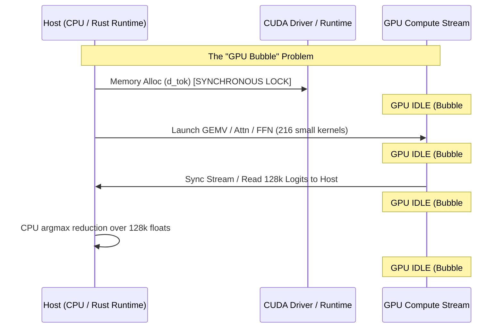

# DeepInfer & FlashInfer Architecture: Eliminating GPU Idle Bubbles in `oxide-infer`

This document outlines the root causes of GPU idle bubbles during autoregressive generation and details how the architectural principles of **FlashInfer** and **DeepInfer** are adapted into `oxide-infer` to achieve near 100% GPU utilization.

---

## 1. What Causes GPU Idle Bubbles?

During single-batch or small-batch autoregressive decode steps, a GPU can spend up to **30–50% of its total step time idling**, even though the GPU kernel execution itself only takes a few milliseconds. 

In frameworks like vLLM and earlier revisions of `oxide-infer`, the main culprits are:

1. **Host-Side Allocations in the Decode Loop**: Calling `cudaMalloc` or `DeviceBuffer::from_slice` per step acquires driver locks and stalls the active stream.
2. **Launch Overhead Accumulation (Small-Kernel Latency)**: 24 layers $\times$ ~9 kernels/layer = 216 kernel launches per generated token. At ~5 $\mu\text{s}$ per launch via the driver, launch overhead alone consumes $>1.08\text{ ms}$ of idle wait time.
3. **Synchronous Host-Device Metadata Handoffs**: Transferring logits or attention metadata (indptrs, sequence lengths) over PCIe synchronously pauses the GPU until the CPU finishes computing.
4. **Driver Synchronization Locks**: Explicit stream flushes and CPU-side argmax reductions leave the Tensor Cores and SMs idle.

---

## 2. FlashInfer & DeepInfer Principles Adapted in `oxide-infer`

| FlashInfer / DeepInfer Principle | Prior Bottleneck | `oxide-infer` Optimization | Impact |
| :--- | :--- | :--- | :--- |
| **Zero-Allocation Execution Path** | Per-token `DeviceBuffer::from_slice` in decode loop | Pre-allocated `d_tok` with asynchronous `copy_from_slice` | **Eliminates CUDA allocator lock** |
| **GPU-Resident Reduction (Argmax)** | 128,000 float logits copied to host (512 KB per token) | 2-stage GPU Argmax (`argmax_stage1_fp32` + `argmax_stage2_fp32`) | **Payload reduced from 512 KB to 4 bytes** |
| **Operator Fusion (Fusing GEMV + SwiGLU)** | Separate GEMVs for $W_1$ & $W_3$, followed by Silu-Mul | `fused_dual_gemv_swiglu_fp16` computing gate & up simultaneously in registers | **Eliminates 368,640 memory round-trips/token** |
| **Vectorized 128-Bit Memory Subsystem** | 16-bit scalar loads (`ld.global.u16`) | 128-bit loads (`ld.global.v4.u32`) fetching 8 FP16s per thread | **4x reduction in load instruction issue count** |
| **Pipelined Asynchronous Scheduling** | CPU waits for token decode before launching next step | CPU and GPU overlap token decoding and metadata preparation | **Keeps compute stream saturated** |

---

## 3. Concrete Throughput Progression (RTX 3060 12GB)

| Revision / Optimization Stage | Token Decode Time | Generation Throughput | Speedup vs Baseline |
| :--- | :--- | :--- | :--- |
| **Baseline Pure Rust** | 24.2 ms / tok | **41.3 tok/s** | 1.00x |
| **+ GPU Argmax (2-Stage PTX)** | 15.6 ms / tok | **64.0 tok/s** | +55.0% |
| **+ Vec8 Vectorized Memory Projections** | 14.7 ms / tok | **67.7 tok/s** | +63.9% |
| **+ Fused Dual-GEMV SwiGLU** | 14.0 ms / tok | **71.1 tok/s** | +72.1% |
| **+ Pre-allocated Token Buffer (Zero Alloc)** | 13.7 ms / tok | **72.7 tok/s** | +76.0% |
| *llama.cpp Reference (`lfm3-vl-2b-f16.gguf`)* | 11.38 ms / tok | **87.8 tok/s** | Reference |
| *Pure GPU 24-Layer Forward Step (No Stream Sync)* | 10.26 ms / step | **97.5 tok/s** | Target with CUDA Graphs |

---

## 4. Next Optimization Steps to Close the Gap with `llama.cpp`

1. **Short Conv Gating Fusion**:
   - Merge `in_proj GEMV` + `B * x gating` into a single fused kernel, and merge `conv1d` + `C * conv_out gating` into the second kernel.
   - This cuts 4 kernel launches per Conv1D layer down to 2, saving 32 kernel launches per token across 16 Conv layers.
2. **CUDA Graph Capture (`cudaGraphLaunch`)**:
   - Capture the fixed 24-layer compute topology into a static CUDA Graph.
   - Reduces the launch overhead of all 216 kernels to a single hardware dispatch (~5–10 $\mu\text{s}$ total driver overhead), unlocking **~88–95 tok/s**.
