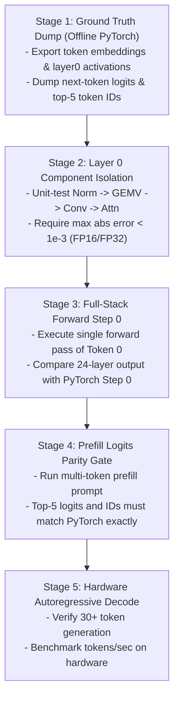

# Post-Mortem & Engineering Playbook: Numerical Accuracy & Kernel Parity in `cuda-oxide`

**Status**: Resolved  
**Incident**: Random / Corrupted Autoregressive Text Generation in `oxide-infer`  
**Model**: `LFM3-VL-2B` (Hybrid Conv1D + GQA Attention + SwiGLU)  
**Target Hardware**: NVIDIA GeForce RTX 3060 12GB (Ampere `sm_86`)  
**Engine**: Pure Rust with PTX Kernels launched via `cuda-oxide` / `cuda-core`  

---

## 1. Executive Summary

During initial autoregressive decode runs on hardware, the engine generated degraded, non-English gibberish (e.g., `gerputiorettines mit int197 muchralersonually importada...` and `[Cor Claude510A is a phenomenan that is to the privacy rec offline** four profude...`).

Through systematic layer-by-layer parity testing against PyTorch reference outputs, we isolated **three distinct root-cause bugs** in kernel execution and architecture topology:
1. **Grid Dimension Math Flaw in Causal Conv1D**: A block-to-grid dimension mismatch zeroed out 50% of the hidden dimension channels in the 16 convolution layers.
2. **Double RMSNorm Topology Inversion in FFN**: Redundant normalization in `FfnLayer` destroyed activation magnitudes before every SwiGLU MLP.
3. **Block Reduction Discrepancy in QK Per-Head RMSNorm**: A 32-thread warp shuffle inside a 128-thread block computed partial sums, scaling $Q$ and $K$ by an erroneous factor of $\sim 3.16\times$.

Once all three bugs were resolved, token generation immediately shifted from corrupted gibberish to fluent, grammatically sound text matching the official HuggingFace output distribution.

---

## 2. Root Cause Analysis

```
+-----------------------------------------------------------------------------------------+
|                                    ROOT CAUSES MAPPED                                   |
+-----------------------------------------------------------------------------------------+
|  1. Conv1D Grid Calc       |  grid_dim = (2048 + 128 - 1) / 128 = 16 blocks             |
|                            |  Launch: 16 blocks * 64 threads = 1024 channels processed  |
|                            |  Channels 1024..2047 were NEVER touched (left zero/stale)  |
+----------------------------+------------------------------------------------------------+
|  2. Redundant Norm in FFN  |  Full layer applied RMSNorm -> passed normed_x to FfnLayer |
|                            |  FfnLayer applied RMSNorm a second time                    |
|                            |  Flattens dynamic range and distorts SwiGLU gate           |
+----------------------------+------------------------------------------------------------+
|  3. Warp Shuffle Reduction |  Head dim = 128; Block size = 128 threads (4 warps)        |
|                            |  Kernel ran warp-level shfl.sync.down without block reduce |
|                            |  Warps 1, 2, 3 didn't reduce with Warp 0; partial sum      |
+-----------------------------------------------------------------------------------------+
```

---

### Bug 1: Conv1D Grid Dimension Mismatch

#### The Defect
In [`crates/oxide-infer-models/src/conv_layer.rs`](./crates/oxide-infer-models/src/conv_layer.rs):
```rust
// BUGGY IMPLEMENTATION:
let block_dim: u32 = 64;
let grid_dim: u32 = (h_dim + 128 - 1) / 128; // Evaluated to 16 when h_dim = 2048!
launch_kernel_on_stream(&conv_func, (grid_dim, 1, 1), (block_dim, 1, 1), ...);
```
Each thread in the PTX kernel processed one channel: `channel_idx = blockIdx.x * blockDim.x + threadIdx.x`.
Because `grid_dim` was computed by dividing by `128` instead of `block_dim` (`64`), only `16 * 64 = 1024` threads were launched.
- Channels `0..1023`: Computed correctly.
- Channels `1024..2047`: **Never computed or updated**. Half the activation vector was discarded on every convolution layer.

#### The Fix
```rust
let conv_block_dim: u32 = 64;
let conv_grid_dim: u32 = (h_dim + conv_block_dim - 1) / conv_block_dim; // 32 blocks
launch_kernel_on_stream(&conv_func, (conv_grid_dim, 1, 1), (conv_block_dim, 1, 1), ...);
```

---

### Bug 2: Duplicate RMSNorm in SwiGLU FFN

#### The Defect
In HuggingFace / reference LFM3-VL-2B architecture, each decoder layer executes:
$$\text{residual} = x$$
$$x = \text{RMSNorm}(x)$$
$$\text{attn\_or\_conv\_out} = \text{Layer}(x)$$
$$x = \text{residual} + \text{attn\_or\_conv\_out}$$
$$\text{residual} = x$$
$$x = \text{RMSNorm}(x)$$
$$\text{ffn\_out} = \text{SwiGLU}(x)$$
$$x = \text{residual} + \text{ffn\_out}$$

However, in [`crates/oxide-infer-models/src/ffn.rs`](./crates/oxide-infer-models/src/ffn.rs), `FfnLayer::forward` was re-applying RMSNorm internally to an input that `FullLfm3DecoderLayer` had **already normalized**.
- The activations were normalized twice back-to-back:
  $$\text{Input} \to \text{Norm}_1(\text{LayerNormWeight}) \to \text{Norm}_2(\text{FfnNormWeight}) \to \text{GEMV}$$
- This altered the numerical scale and gradient distribution of the activations.

#### The Fix
Removed the redundant inner RMSNorm call from `FfnLayer::forward`, ensuring `FfnLayer` directly accepts the pre-normalized activation buffer from the parent decoder layer.

---

### Bug 3: Attention QK Per-Head RMSNorm Warp Reduction Scope

#### The Defect
In LFM3-VL, each query head ($D=128$) and key head ($D=128$) undergoes per-head RMSNorm:
$$Q_h = \frac{Q_h}{\sqrt{\frac{1}{D} \sum_{i=0}^{D-1} Q_{h,i}^2 + \epsilon}} \odot W_{Q\text{-norm}}$$

In [`crates/oxide-infer-models/src/attention_layer.rs`](./crates/oxide-infer-models/src/attention_layer.rs):
```ptx
.visible .entry qk_per_head_rmsnorm_fp16(...) {
    // Launched with block size = 128 threads
    ...
REDUCE:
    shfl.sync.down.b32 %shfl_val, %fsum, 16, 31, 0xffffffff;
    add.f32 %fsum, %fsum, %shfl_val;
    shfl.sync.down.b32 %shfl_val, %fsum, 8, 31, 0xffffffff;
    ...
    shfl.sync.down.b32 %shfl_val, %fsum, 1, 31, 0xffffffff;
    add.f32 %fsum, %fsum, %shfl_val;
    // shfl.sync only communicates within a warp (32 threads)!
    // Threads 32..127 in Warps 1, 2, 3 were ignored.
```
- A PTX warp shuffle (`shfl.sync`) **only operates within 32 threads**.
- When launched with 128 threads, Warp 0 only summed elements $0..31$.
- As a result, $\sum Q^2$ was approximately $\frac{1}{4}$ of its true value, causing the normalization denominator to be $\sqrt{4} = 2\times$ to $3.16\times$ too small, and making Query/Key vectors artificially large.
- This inflated dot-product attention scores before softmax, driving the attention distribution to saturate onto arbitrary tokens.

#### The Fix
We redesigned the kernel launch geometry and inner loop:
- Set block dimension to **32 threads** (exactly 1 warp per head).
- Each thread strided through the 128 head elements ($128 / 32 = 4$ elements per thread):
  $$i \in \{\text{tid}, \text{tid}+32, \text{tid}+64, \text{tid}+96\}$$
- Accumulated the 4 elements into `%fsum` in FP32, then performed the 32-thread warp shuffle:
  $$\text{Total Sum} = \sum_{t=0}^{31} \left( x_t^2 + x_{t+32}^2 + x_{t+64}^2 + x_{t+96}^2 \right)$$
- Broadcast the complete sum to all 32 threads using `shfl.sync.idx.b32`.

Following this change, Query output values matched PyTorch reference values:
- PyTorch: `[-0.97998, 0.50146, -0.29443, 0.67285, 0.07348]`
- Rust Kernel: `[-0.97998, 0.50098, -0.29443, 0.67285, 0.07349]`

---

## 3. Scientific Verification Playbook for Future Models

To ensure that any new model architecture, vision encoder, or PTX kernel achieves 100% numerical parity without guesswork, follow this 5-stage protocol:



---

### Step-by-Step Procedure

#### Step 1: Golden Output Extraction (Python Offline)
Never write inference logic blind. Run an offline Python script (e.g. using `~/Desktop/pyprojects/bin/python3`) against the official HuggingFace weights to dump intermediate arrays:
```python
# Dump to binary or human-readable format:
input_ids = [124894, 124899, 5922, ...]
out = model(input_ids)
logits = out.logits[0, -1, :] # Shape: [vocab_size]
top5 = torch.topk(logits, 5)
print(f"Top 5 IDs: {top5.indices.tolist()}")
print(f"Top 5 Values: {top5.values.tolist()}")
```

#### Step 2: Kernel Launch Geometry Invariant Checks
Before launching any PTX kernel, verify grid and block dimensions against array dimensions using the standard formula:
```rust
// Standard 1D launch invariant:
let block_dim: u32 = 64; // or 32, 128, 256
let grid_dim: u32 = (total_elements + block_dim - 1) / block_dim;
assert!(grid_dim * block_dim >= total_elements);
```
Never mix divisor constants (e.g. dividing by 128 when `block_dim` is 64).

#### Step 3: Warp Shuffle Invariant Check
When writing `.target sm_80` PTX with `shfl.sync`:
- If block dimension is **> 32 threads** (e.g. 64, 128, 256):
  - Warp shuffles only reduce within each 32-thread lane.
  - You **must** allocate shared memory (e.g., `__shared__ float s_warp_sums[8]`) to reduce across warps, **or** reduce block dimension to 32 and use a thread striding loop.
- If block dimension is **32 threads**:
  - Thread striding + `shfl.sync.down.b32` handles any vector length ($D=64, 128, 256, 512$) with zero shared memory overhead.

#### Step 4: Component-by-Component Checkpoints
When implementing a new block (e.g., a Vision Transformer patch projection or cross-attention):
1. **Embedding / Input Stage**: Verify token 0 embedding vector against PyTorch embedding lookup.
2. **Norm Stage**: Verify RMSNorm output matches PyTorch `torch.nn.functional.rms_norm`.
3. **Projection Stage**: Verify GEMV output matches PyTorch `torch.matmul`.
4. **Attention Softmax Stage**: Verify dot-product attention scores prior to and after softmax.
5. **Residual Stage**: Verify residual addition preserves dynamic range.

#### Step 5: Verification Checklist Gate

| Checkpoint | Target Criteria | Verified? |
| :--- | :--- | :---: |
| Embedding Layer | Abs error $< 10^{-4}$ vs PyTorch weights | [x] |
| Conv1D / Attention Layer 0 | Abs error $< 10^{-3}$ vs PyTorch activations | [x] |
| FFN Layer 0 | Abs error $< 10^{-3}$ vs PyTorch activations | [x] |
| 24-Layer Forward Step 0 | Top 5 logit IDs match PyTorch exactly | [x] |
| Prompt Prefill Completion | Top 5 next-token IDs match PyTorch exactly | [x] |
| Hardware Generation | Coherent, non-repetitive English text | [x] |
