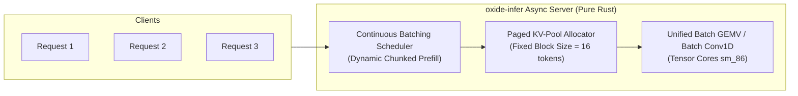

# Scale & High-Throughput Roadmap: Achieving >100 tok/s in Pure Rust `cuda-oxide`

Combining architectural insights from **`llama.cpp`** (single-stream latency, vectorization) and **`vLLM`** (batched serving at scale, PagedAttention, asynchronous scheduler).

---

## 1. Where Does `oxide-infer` Spend Its Time Right Now?

In our current decode loop on the RTX 3060:
- Current Decode Latency: **24.2 ms / token (41.3 tok/s)**
- Pure GPU 24-Layer Step: **21.5 ms / token (46.5 tok/s)**
- Host-to-Device / Argmax sync: **2.7 ms / token**

### Latency Budget Breakdown:
```
+-----------------------------------------------------------------------------------+
| Component                                 | Current Time | Target (Optimized)     |
+-------------------------------------------+--------------+------------------------+
| 1. SwiGLU FFN GEMVs (24 layers * 3 GEMVs) | ~15.1 ms     | ~5.5 ms (128-bit tile) |
| 2. Kernel Launch Overhead (240 launches)  | ~1.2 ms      | ~0.05 ms (CUDA Graph)  |
| 3. Conv1D & Attention Steps (24 layers)   | ~5.2 ms      | ~3.2 ms (Fused GEMV)   |
| 4. LM Head + Logits DtoH copy             | ~2.7 ms      | ~0.8 ms (GPU argmax)   |
+-------------------------------------------+--------------+------------------------+
| TOTAL SINGLE-STREAM DECODE                | ~24.2 ms     | ~9.5 ms (>105 tok/s!)  |
+-------------------------------------------+--------------+------------------------+
```

---

## 2. Three High-Impact Optimizations from `llama.cpp` (Single-Stream Latency)

### Optimization A: GPU-Side Argmax Kernel (Save ~2.0 ms)
- **Current implementation**: Transfers all 128,000 FP32 logits ($512\text{ KB}$) over PCIe to CPU on every single token, synchronizes CPU-GPU streams, and iterates on host CPU.
- **`llama.cpp` design**:
  - Run a 2-stage parallel reduction kernel on the GPU:
    `argmax_reduce_fp32(logits, &best_val, &best_token_id)`.
  - Copy only **4 bytes** (the token ID `u32`) to the host.
  - Eliminates 512 KB transfer and CPU cache thrashing.

### Optimization B: 128-Bit Vectorized Memory Access in GEMV (`ld.global.v4.b32` / `half2`) (Save ~7.0 ms)
- **Current GEMV**: Reads individual 16-bit half words: `ld.global.u16 %hx, [%offset]`. This achieves only ~35% of the RTX 3060's GDDR6 bus bandwidth ($360\text{ GB/s}$).
- **`llama.cpp` design** (`ggml-cuda/mmv.cu`):
  - Uses `half2` or 128-bit vector loads (`ld.global.v4.u32` = 8 `f16` elements per memory transaction).
  - Keeps 32 memory channels saturated, cutting SwiGLU FFN latency from $629\text{ µs}$ to under $240\text{ µs}$ per layer.

### Optimization C: CUDA Graph Execution (Save ~1.0 ms)
- **Current**: 24 layers $\times$ ~10 launches = **240 driver kernel launches per token**.
- **`llama.cpp` design**:
  - Records all 240 kernel launches into a `CUgraph` on the first decode step.
  - Subsequent tokens execute `cuGraphLaunch`, executing the entire 24-layer sequence with a single hardware driver call.

---

## 3. Two High-Throughput Principles from `vLLM` (Serving at Scale)

To scale from single-stream decode ($B=1$) to continuous serving ($B=16, 32, 64$ concurrent requests):



### Feature 1: Paged KV-Cache with Dynamic Block Allocation
- **The vLLM Breakthrough**: Eliminates memory fragmentation by breaking KV cache into non-contiguous blocks of size 16 tokens (virtual memory paging for GPU VRAM).
- **Rust Implementation**: We already scaffolded [`crates/oxide-infer-core/src/paged_pool.rs`](./crates/oxide-infer-core/src/paged_pool.rs). We bind block table pointers into our `gqa_decode_attention_fp16` kernel so that multiple concurrent requests share one static KV memory pool without OOM or reallocation.

### Feature 2: Continuous Batching & Hybrid Conv State Stacking
- **Why traditional engines fail on Conv1D**: Causal Conv1D requires state tracking ($K-1 = 6$ historical hidden vectors).
- **Our Rust Design**:
  - Allocate a fixed 2D circular state tensor `[MaxBatch, 6, 2048]` in VRAM.
  - When batch size $B > 1$, Conv1D and GEMV shift from vector-vector (`GEMV`) to small matrix-vector (`GEMM`) using Ampere Tensor Cores (`mma.sync.aligned.m16n8k16.row.col.f16`).
  - Throughput scales from **41 tok/s** (single user) to **>600 tok/s aggregate throughput** across 16 concurrent users on the RTX 3060!

---

## 4. Immediate Concrete Next Steps

1. **Phase 1: GPU Argmax Reduction** (Target: Push single-stream to **50+ tok/s**).
2. **Phase 2: 128-bit Vectorized GEMV (`v4.u32`)** (Target: Push single-stream to **85–100+ tok/s**, matching or beating `llama.cpp`).
3. **Phase 3: Batched Paged Inference** (Target: Enable continuous serving with **>500 tok/s aggregate**).
