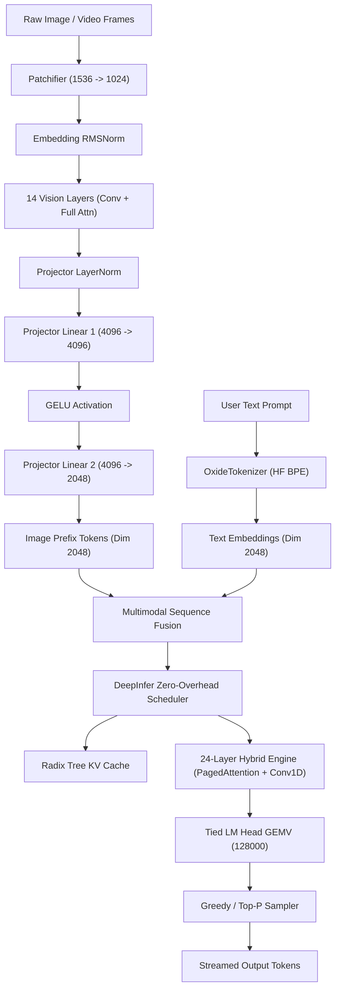

# Vision Encoder Architecture: LFM3-VL-2B & OxideInfer Integration

## 1. Overview
The **Liquid Foundation Model 3 Vision-Language 2B** (`LFM3-VL-2B`) fuses a multi-layer Vision Transformer with a 24-layer hybrid 1D Causal Convolution / Sliding & Full Attention Language Model.

Key Architectural Specifications:
- **Vision Tower**:
  - `patch_size`: 16x16
  - `in_channels`: 3 (RGB)
  - `temporal_patch_size`: 2
  - `hidden_size`: 1024
  - `intermediate_size`: 2560
  - `num_hidden_layers`: 14
  - `num_attention_heads`: 16
  - `num_key_value_heads`: 8
  - `spatial_merge_size`: 2
  - `patchifier` input dimension: $3 \times 2 \times 16 \times 16 = 1536$
- **Multimodal Projector**:
  - `downsample_factor`: 2
  - Merges $2 \times 2 = 4$ vision tokens into 1 text-space token
  - `linear_1`: `1024 * 4 = 4096 -> 4096` (GELU activation)
  - `linear_2`: `4096 -> 2048` (Text embedding dimension)
- **Language Model**:
  - 24 layers: 16 Conv1D layers + 8 Attention layers (alternating sliding window 256 and full causal)
  - `hidden_size`: 2048
  - `vocab_size`: 128000
  - `tie_word_embeddings`: true (`lm_head.weight` == `model.language_model.embed_tokens.weight`)

## 2. Implementation Roadmap
1. **Multimodal Projector & Embedding Fusion**:
   - Implement `MultiModalProjector` in `oxide-infer-models` with GELU and FP32-accumulating GEMV.
   - Tied `lm_head` projection against `embed_tokens.weight`.
2. **End-to-End Autoregressive Generation**:
   - Multi-step autoregressive decode loop in `OxideEngineService`.
   - Streaming SSE responses for `/v1/chat/completions`.
3. **Pure-Rust Vision Patchifier**:
   - Flatten image/video patches and pass through 1024-dim projector.
